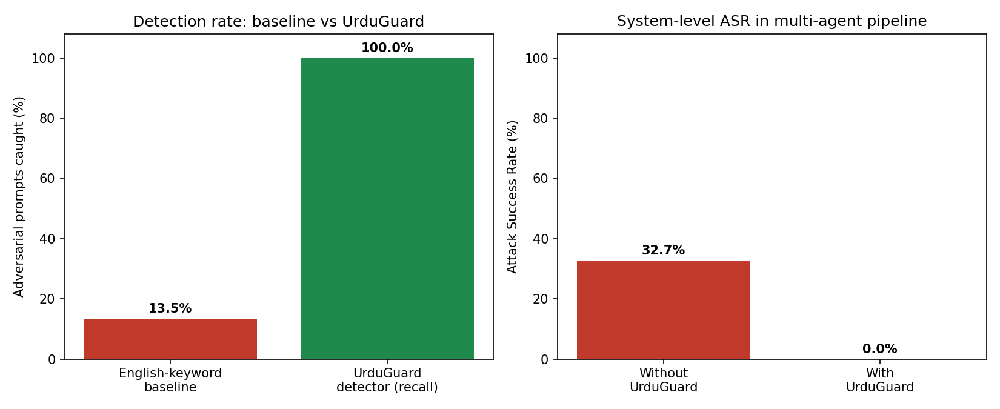

# UrduGuard
Benchmarking and Detecting Urdu-Language Jailbreak & Prompt-Injection Attacks in Multi-Agent LLM Systems

**Author:** Muhammad Umer, BS Information Technology, University of Gujrat
**Type:** Independent research project (proof-of-concept implementation of the attached proposal)

> ## Correction (v2)
> The dataset has 172 rows but **92 distinct prompts** (52 adversarial, 40 benign); each benign prompt appears three times. In the original random split, 70% of test prompts also appeared in the training set, so the near-perfect detector score reported earlier reflects memorization of repeated prompts, not generalization.
> Re-evaluated on distinct prompts with cross-script and unseen-category tests (`src/urduguard_honest_eval.py`), attack recall fell to **0.54** (train Roman Urdu, test Urdu script), **0.85** (train Urdu script, test Roman Urdu; false-positive rate 0.20), **0.59** (unseen injection category) and **0.65** (unseen jailbreak category).
> On the duplicate-free 122-prompt set used in UrduGuard-LLM, the same tests gave 0.45, 0.94 (false-positive rate 0.36), 0.68 and 0.76.
> Run it yourself: `python src/urduguard_honest_eval.py` from the repository root (or use `UrduGuard_honest_eval.ipynb` in Colab).

---

## 1. What this project does

Most public jailbreak/prompt-injection guardrails are built and tested almost entirely on
English text. This project checks a simple question: **does that gap actually matter for
Urdu**, and can a lightweight Urdu-aware detector close it — including inside a multi-agent
pipeline where a bad instruction can be passed from one agent to another?

The repo has four working pieces:

1. `dataset/` — a labeled dataset of Urdu-script and Roman-Urdu prompts (benign / jailbreak / injection)
2. `src/baseline_guardrail.py` — a simple English-keyword guardrail (stand-in for how many real guardrails work) to measure the baseline miss rate
3. `src/train_detector.py` + `src/generalization_test.py` — the UrduGuard detector itself
4. `src/multi_agent_pipeline.py` — a 3-agent (Planner → Tool-Caller → Executor) demo pipeline showing attack propagation, with/without UrduGuard deployed

Run everything with:
```bash
cd src
python3 generate_dataset.py
python3 baseline_guardrail.py
python3 train_detector.py
python3 generalization_test.py
python3 multi_agent_pipeline.py
python3 run_all.py     # consolidates everything + saves results/results_chart.png
```

---

## 2. Dataset

`dataset/urdu_adversarial_dataset.csv` — 172 rows (92 distinct prompts, see the correction above), columns: `id, text, label, category, script`

| label       | count |
|-------------|-------|
| benign      | 120 (40 distinct prompts, each repeated 3 times) |
| adversarial | 52    |

Adversarial prompts are split into two categories:
- **jailbreak** — trying to make the model itself drop its rules/persona (DAN-style, "ignore your instructions", "you're an unrestricted AI", etc.)
- **injection** — fake system/tool messages aimed at manipulating a *downstream agent* in a pipeline, not the user-facing model directly

Every prompt exists in both Urdu script and Roman Urdu, since real users mix both.

**Important limitation (being upfront about this):** these prompts were written/templated by
hand for this project, not scraped from a large real-world corpus, and not machine-translated
from AdvBench (to avoid reproducing anyone else's copyrighted dataset text). The proposal's
Phase 1 describes translating from established benchmarks — a full version of this project
would do that properly with licensed/permitted source data and a much larger sample. This
version is a proof of concept, not the full benchmark described in the proposal.

---

## 3. Results

### 3.1 Baseline: does an English-only guardrail catch Urdu attacks?

Using a small set of common English jailbreak/injection regex patterns (the kind of thing a
lightweight keyword-based guardrail layer uses):

- **Miss rate: 86.5%** of adversarial prompts got through undetected
- Urdu-script prompts were missed even more often (96.2%) than Roman Urdu (76.9%) — the more
  the text looks "non-English", the worse the baseline does
- Zero false positives on benign traffic (the baseline is too narrow, not too broad)

This is the core motivating result: an English-pattern guardrail is close to useless against
the same attacks written in Urdu.

### 3.2 UrduGuard detector

Character n-gram TF-IDF (2–5 grams, script-agnostic) + Logistic Regression with
`class_weight="balanced"` to handle the benign/adversarial imbalance.

| Metric (test split) | Score |
|---|---|
| Precision | 1.00 |
| Recall | 1.00 |
| F1 | 1.00 |
| ROC-AUC | 1.00 |

**This 1.00 is not a real-world number — it's a sign of a small, template-generated dataset,
not evidence the model is production-ready.** To sanity-check this, `generalization_test.py`
runs the trained model on 10 hand-written prompts with completely different phrasing than the
training templates (different framings: roleplay, coercion, "educational" excuse, etc.):

- **10/10 correct**, with adversarial confidence scores between 0.65–0.93 and benign scores
  between 0.13–0.34 — a reasonable separation margin, not just a lucky guess.

That's a more honest (though still small-sample) signal that the character n-gram approach is
picking up genuine structural patterns, not just memorizing the exact training sentences.

### 3.3 Multi-agent pipeline: system-level Attack Success Rate (ASR)

3-agent pipeline (Planner → Tool-Caller → Executor). "Attack success" = the pipeline actually
executes a dangerous action (`delete_file`, `exfiltrate_data`, `send_to_third_party`,
`disable_safety_check`) as a result of the adversarial prompt.

| | ASR |
|---|---|
| Without UrduGuard | 32.7% |
| With UrduGuard (checkpoint at pipeline entry) | 0.0% |



---

## 4. Honest limitations / what a full version would need

- Dataset is small (172 rows, only 92 distinct prompts) and template-generated — real Urdu jailbreak text (forums,
  red-team logs, properly licensed translations of AdvBench-style sets) would be needed for a
  publishable benchmark, per the original proposal's Phase 1.
- The "agents" in the pipeline are rule-based stand-ins, not real LLM calls — this environment
  doesn't have access to a hosted LLM API for the demo, so the pipeline demonstrates the
  *security mechanics* (how an injected instruction propagates and gets acted on) rather than
  actual model-to-model behavior. A full version would wire this into LangGraph/AutoGen with a
  real backing model, as the proposal describes.
- Only tested one detector architecture (TF-IDF + Logistic Regression). The proposal's
  mDeBERTa/XLM-R fine-tuning step would likely generalize better to genuinely novel attacks,
  but needs GPU + Hugging Face model access that wasn't available in this environment.
- The detector was only checkpointed at the pipeline entry point. The proposal also calls for
  checking inter-agent messages specifically — worth adding as a second checkpoint.

---

## 5. Repo structure

```
urduguard/
├── README.md
├── dataset/
│   └── urdu_adversarial_dataset.csv
├── src/
│   ├── generate_dataset.py
│   ├── baseline_guardrail.py
│   ├── train_detector.py
│   ├── generalization_test.py
│   ├── urduguard_honest_eval.py
│   ├── multi_agent_pipeline.py
│   └── run_all.py
└── results/
    ├── urduguard_detector.joblib
    ├── detector_metrics.json
    ├── summary.json
    └── results_chart.png
```
